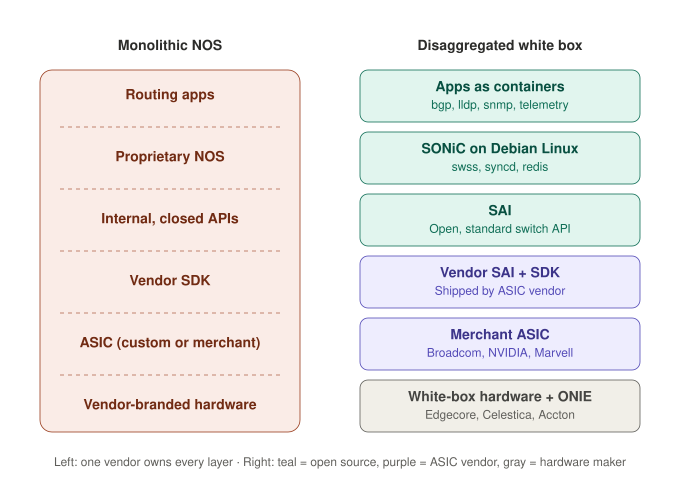

# Chapter 1 — Disaggregated Networking & SONiC Design Philosophy

> Part I — Installation, System Topology & Build · [Back to index](../../README.md)

## 1.1 Monolithic NOS vs. disaggregated white box

### 1.1.1 The two parts of a switch

Every network switch has two parts:

1. **Hardware** — the box: ports, CPU, power supplies, and the switching chip (ASIC) that
   forwards packets.
2. **Software** — the network operating system (NOS) that runs on it: routing protocols, CLI,
   management and monitoring.

The difference between monolithic and disaggregated comes down to two questions:
**who makes each part**, and **how much can you change it**.

- **Monolithic NOS** — one vendor makes both the hardware and the software and sells them as one
  locked product. You cannot run another OS on their box, or their OS on another box.
- **Disaggregated white box** — hardware and software are bought separately, from different
  companies. A generic switch, called a *white box*, is built by an
  **ODM (Original Design Manufacturer)** — a company that designs and builds hardware sold
  unbranded or under other companies' brands — and runs an open NOS such as SONiC.

### 1.1.2 A spectrum, not two boxes

Real products fall between the two extremes:

| Model | Hardware made by | Software made by | Can you change things? |
|---|---|---|---|
| Fully integrated (classic Cisco IOS, Junos) | Vendor | Same vendor, closed | No — you use what they give you |
| Open but single-vendor (Arista EOS) | Vendor | Same vendor, Linux underneath | A little — you can run your own scripts and agents, but only on their hardware and their OS |
| Brite box | Big-name vendor | SONiC, supported by that vendor | Yes — open software, one company to call |
| White box + commercial SONiC | ODM (Edgecore, Celestica…) | SONiC, supported by a company you pay | Yes — hardware and software from different companies |
| White box + community SONiC | ODM | Free community SONiC | Fully — you own everything, including the problems |

Going down the table:

- **Freedom and control increase** — you choose the hardware, change the software, and fix
  things yourself.
- **Box price decreases** — no big-brand markup.
- **Responsibility moves to you** — at the top, the vendor fixes everything; at the bottom, you do.

Microsoft sits in the last row because it has the engineers to own everything. A small company
with three network engineers usually sits in the top or middle rows.

### 1.1.3 "Monolithic" has two meanings

The word is used in two ways, and mixing them up causes confusion:

1. **Monolithic as a product** — hardware and software locked together by one vendor. This is
   the meaning in the table above.
2. **Monolithic as software design** — the whole OS runs as one program. Classic Cisco IOS
   worked this way: one binary image, with all features sharing one memory space and no
   protection between them. A bug in SNMP could crash the whole switch, and fixing one bug
   meant replacing the whole image.

Modern vendor operating systems — **Arista EOS**, Cisco IOS XR, Junos — are no longer monolithic
in the second sense. In EOS:

- each feature (BGP, LLDP, STP…) runs as a separate Linux process, called an **agent**;
- agents don't talk to each other directly; they read and write a central state database
  called **Sysdb**;
- if an agent crashes, a process manager restarts it, it reloads its state from Sysdb, and the
  switch keeps forwarding packets.

SONiC's design is very similar: each feature is a separate process (in a container), and
**Redis** plays the role of Sysdb.

**So the honest comparison is:** EOS and SONiC have about the same crash isolation, because both
use separate processes and a shared state database. EOS is still monolithic in the *first*
sense — it runs only on Arista hardware, and only Arista can change its code.

### 1.1.4 Where SONiC is better than a process-based NOS like EOS

If crash isolation is the same, what does SONiC actually add?

#### 1. Hardware independence — the biggest difference

EOS runs only on Arista switches. SONiC runs on any switch whose chip vendor provides
**SAI (Switch Abstraction Interface)** — a standard API between the NOS and the chip.

**Example — buying new hardware.** You need 400G/800G switches, or your current model has a
12-month delivery time, as many operators faced during the 2021–22 chip shortage.

- **EOS:** you buy what Arista sells, when Arista can ship it.
- **SONiC:** the same chip (say, Broadcom Tomahawk) is sold in boxes from several ODMs. You can
  buy from two suppliers and run the same SONiC image, configuration templates and automation on
  both. Even moving to a different chip vendor mostly means swapping the `syncd` container and
  its SAI library.

**The catch:** each new hardware model still needs testing — optics, platform drivers, buffer
tuning. Much easier than changing NOS vendors, but not zero work.

#### 2. Open source — you control how fast fixes arrive

**Example — a bug in production.** The SNMP process leaks memory. After a few weeks, CPU spikes
and BGP sessions flap on 300 switches.

**With a vendor NOS (even a process-based one):**

1. You can restart the SNMP agent — same as SONiC, thanks to process isolation.
2. To actually fix it, you open a support case and help the vendor reproduce it.
3. The vendor plans the fix for a future release, often weeks or months away.
4. The fix arrives inside a new full OS image, with many other changes you didn't ask for.
5. You test the whole image and upgrade all 300 switches, with reboots or in-service upgrades.

**With SONiC:**

1. Restart the `snmp` container — same as above.
2. Your engineers can read the source and find the leak, or pick up a fix from the community or
   your SONiC vendor.
3. Rebuild only the SNMP container, test that one change, and roll it out.

**What this shows:** SONiC doesn't have fewer bugs — every NOS has bugs. With SONiC, *you*
decide how long a fix takes and how much you have to change to apply it.

**The catch:** this works only if you have engineers who can read code, build images and own
the result.

#### 3. Containers — packaging and ownership, not just isolation

A process is a unit of *execution*. A container is also a unit of **packaging and ownership**,
which gives SONiC benefits processes alone don't:

| Benefit | Why it matters |
|---|---|
| Each component brings its own libraries | FRR, the SNMP agent, telemetry and the vendor's `syncd` can each use different library versions without conflict |
| Code from many owners stays separate | FRR from an open-source project, SAI/SDK from the chip vendor, teamd and lldpd from other projects — each built and versioned on its own. EOS needs this less, since Arista writes nearly everything |
| Upgrade one component | Replace only the `bgp` image. EOS supports patches, but its normal model is whole-image upgrade |
| Run multiple copies | Multi-ASIC switches run one set of containers per chip (`swss0`/`syncd0`, `swss1`/`syncd1`…) |
| Standard tooling | Docker images, registries, `docker logs`, server CI/CD pipelines work as-is |

**The catch:** many SONiC containers run with full privileges and the host's network, because
they need direct hardware access. Their *security* isolation is weak — the boundaries are mostly
organizational.

#### 4. Same data model on every switch, from every vendor

**Example — monitoring.** You want queue and buffer statistics from every port every few
seconds, plus your own health-check program on every switch.

**First, what no NOS can change:** hardware counters are limited by the chip. If the ASIC
doesn't count something, no software can report it. If the ASIC counts it but the chip vendor's
SAI doesn't expose it, you have to ask the chip vendor — whether you run SONiC, EOS or anything
else.

| Layer | Owned by | Decides |
|---|---|---|
| ASIC hardware | Chip vendor | Whether the counter physically exists |
| SDK | Chip vendor | Whether software can read it |
| SAI | Chip vendor's implementation of the OCP standard | Whether it has a SAI stat ID (`SAI_PORT_STAT_…`) |
| SONiC (syncd / FlexCounter) | You or the community | Whether it is polled and written to `COUNTERS_DB` |

**With a vendor NOS:** EOS is quite open — it has APIs, streaming telemetry, and lets you run
your own agents. But it exposes only what Arista chooses to, and only on Arista hardware. A
network with Cisco, Juniper and Arista means three CLIs, three data formats and three sets of
scripts.

**With SONiC:**

- If SAI already exposes a counter that SONiC doesn't collect, you can add it yourself.
- All state is in Redis tables you can read directly (`COUNTERS_DB`, `STATE_DB`), in the same
  format on every switch from any ODM.
- Much useful monitoring doesn't need new hardware counters at all — rates and trends, Linux CPU
  and memory, control-plane state, checks that combine several tables — and is fully in your
  control.
- For deep debugging, the chip vendor's debug shell is usually available inside the `syncd`
  container (for example `bcmcmd` on Broadcom chips).

**What this shows:** SONiC doesn't remove your dependence on the chip vendor for *hardware
data*. It removes your dependence on a *NOS vendor* for everything above it — how data is
collected, stored, combined and exported.

### 1.1.5 When a monolithic NOS is better than SONiC

Disaggregation is not always the right answer. A vendor NOS is often better in these cases.

#### 1. You need one company to call

**Example:** packets drop now and then between two switches, at 3 a.m.

- **Vendor NOS:** one call. The vendor owns the hardware, chip and software — there's no one
  else to blame.
- **White box + community SONiC:** is it the optic, the ODM's driver, the chip vendor's SAI, or
  SONiC itself? Each party can point at another. Your team has to narrow it down before anyone
  takes ownership.

This is the biggest hidden cost of disaggregation, and why brite boxes and commercial SONiC
exist: they sell back a single point of accountability.

#### 2. You need features SONiC isn't built for

- **Vendor NOS is stronger** in breadth and maturity: MPLS and segment routing for service
  providers, complex routing policy, older protocols, campus features (802.1X, PoE, stacking),
  and smooth in-service upgrades on large chassis — refined over decades.
- **SONiC is stronger** where it was designed to be: data-center leaf/spine networks, BGP,
  EVPN-VXLAN, and the lossless-Ethernet tuning used in AI clusters.

Many companies run SONiC in the data center and a vendor NOS at the WAN edge or campus.

#### 3. Your team is small or operations-focused

A vendor gives you a polished CLI, GUIs, documentation, training, certifications and tested
integrations from day one. With SONiC you build or buy much of that yourself; its value depends
on having people with Linux and software skills.

#### 4. The total cost is lower at small scale

| Cost item | Vendor NOS | SONiC on white box |
|---|---|---|
| Hardware | Vendor price, with a large margin | ODM price, much lower |
| Software | Bundled, often plus feature or port licenses | Free (community) or subscription (commercial) |
| Support | One vendor contract | Several companies, or your own team |
| Team | Network operators | Network engineers who also know Linux and coding |
| Testing and integration | Mostly done by the vendor | Done by you or your SONiC vendor |

- **A cloud company with thousands of switches:** hardware savings are huge and the engineering
  team already exists — SONiC wins.
- **A company with 20 switches:** the cost of the engineers needed can exceed the hardware
  savings — a vendor NOS or brite box usually wins.

### 1.1.6 Summary: when to choose which

**Choose SONiC / disaggregated when:**

- the network is large and uniform (data center, AI cluster)
- you have, or plan to build, a team with Linux and software skills
- fast fixes, automation and visibility matter more than a long feature list
- you want freedom to choose hardware suppliers

**Choose a vendor NOS / integrated when:**

- the network is small or mixed (campus, branch offices, WAN edge)
- you need specialized features (MPLS/SR, campus features, chassis upgrades)
- one accountable company matters more than control
- your team focuses on operations rather than software

**Or choose the middle** — brite box or commercial SONiC — if you want SONiC's openness but
still need a single company to call.

## 1.2 Why Microsoft built SONiC

By the mid-2010s Microsoft was not "a server company" but the operator of Azure — one of the
largest networks in the world. Off-the-shelf switches had become a bottleneck:

- **Scale changes the economics.** Tens of thousands of switches turn small per-box costs and
  vendor quirks into large totals and real operational pain. Waiting months for a vendor fix
  that hits thousands of devices is not acceptable.
- **The switch was the last black box.** Servers, hypervisors and host-side SDN were already
  programmable. Switches still each had a closed OS, its own CLI, upgrade process and
  monitoring. Microsoft wanted to run switches *like servers*.
- **Control over priorities.** Hyperscalers want fewer features, rock-solid, with deep
  visibility and fast fixes — not the longest feature list.
- **The hardware was already commodity.** Merchant ASICs and ODM boxes existed; the missing
  piece was software portable across chips.

**Timeline**

1. **2015** — Microsoft shows *Azure Cloud Switch (ACS)* at the OCP Summit, and with Dell,
   Facebook, Broadcom, Intel and Mellanox proposes **SAI** as an OCP standard.
2. **2016** — ACS evolves into **SONiC**, open-sourced through OCP.
3. **2022** — SONiC moves to the **Linux Foundation**.

**Why give it away?** Open source makes the ecosystem do part of the work: ASIC vendors write
SAI implementations, ODMs certify hardware, other operators contribute features. Microsoft
gains hardware choice and shares maintenance cost.

Microsoft was not alone — Google had built its own switches and software, and Facebook built
Wedge hardware and FBOSS. SONiC became the most widely adopted because it was open and
organized around the SAI standard.

## 1.3 The three pillars: SAI, containers, Redis

*To be written.*

## 1.4 Install path (ONIE) vs. boot path

*To be written.*

## Check yourself

1. EOS and SONiC both restart a crashed process without stopping forwarding. So what is the main
   reason a hyperscaler would choose SONiC over EOS?
2. You need a new buffer counter. In which case can SONiC add it without help from the chip
   vendor, and in which case can't it?
3. A company has three network engineers, no software developers and 40 switches across two
   sites. Which row of the spectrum table fits them, and why?
4. Why do brite-box and commercial SONiC products exist, if community SONiC is free?
